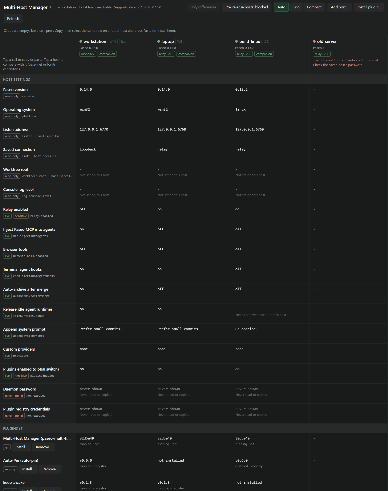
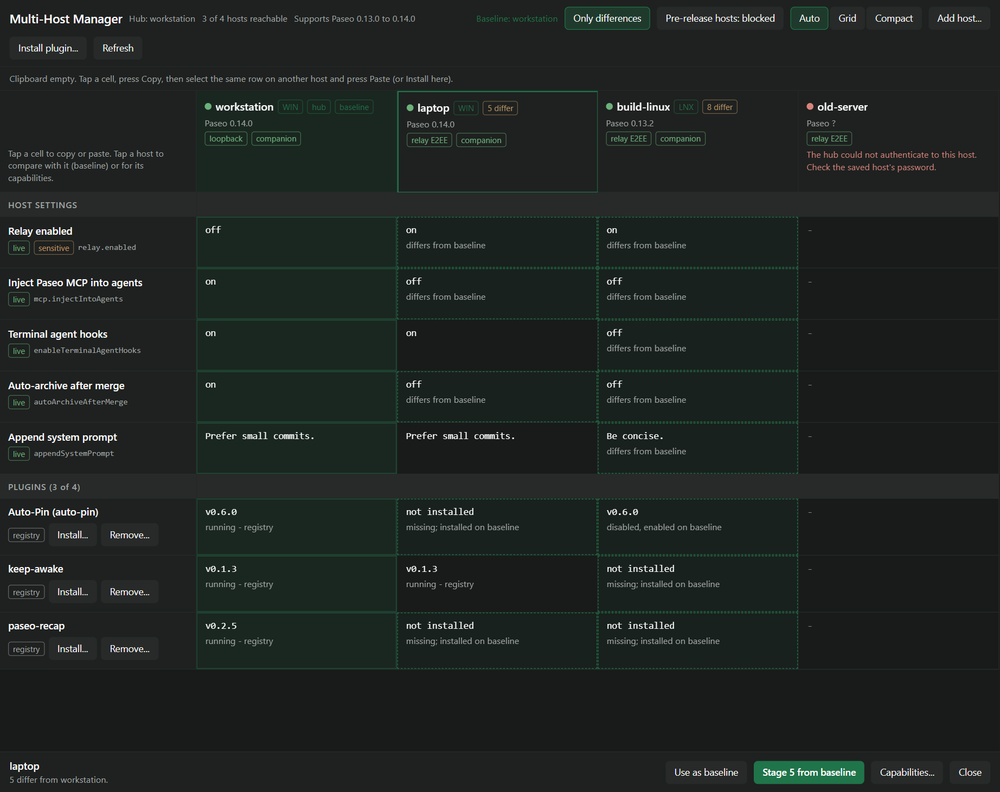
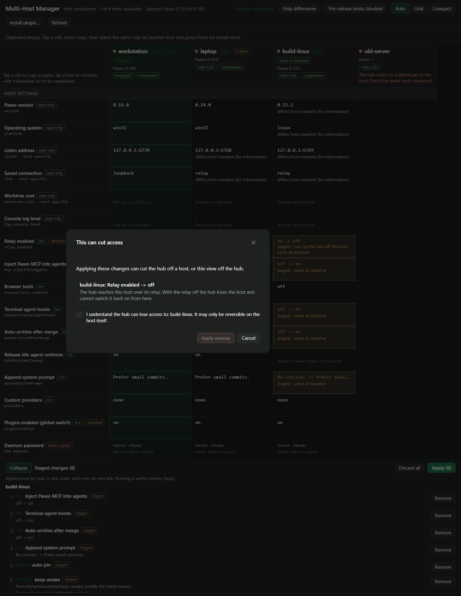
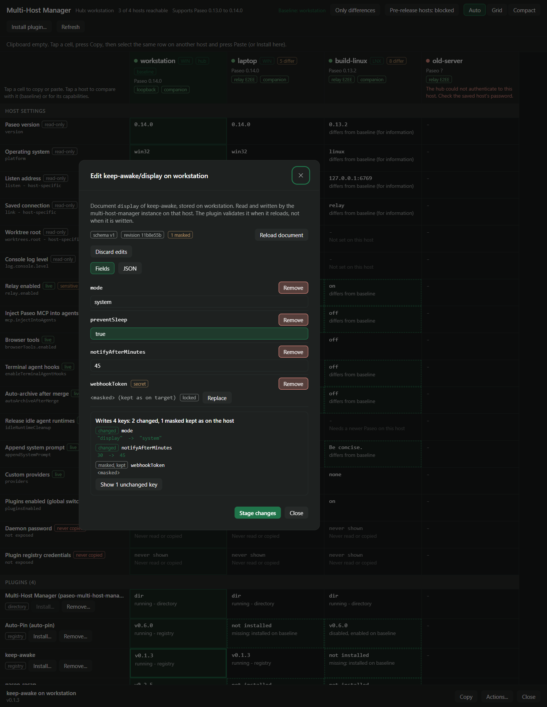
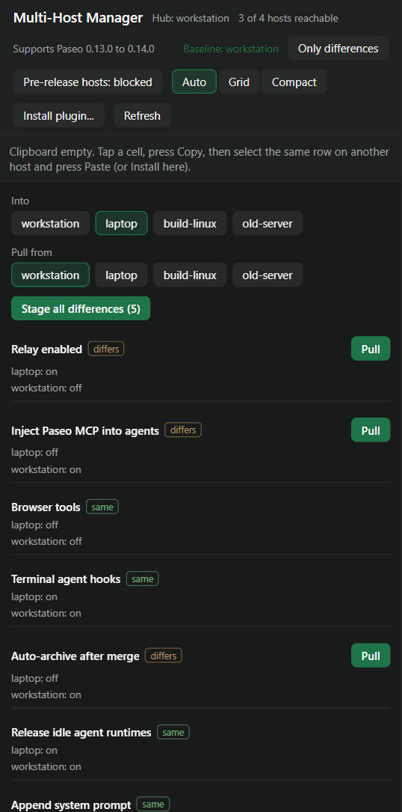
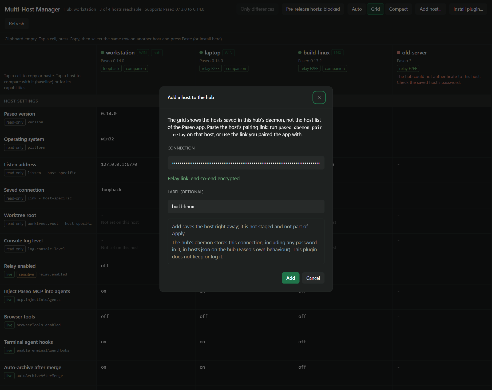

# Multi-Host Manager for Paseo

I run Paseo on a few machines, Windows and Linux, and kept finding that one of them had a different
relay setting, an older plugin or a provider entry I had fixed everywhere else. Checking meant
opening each host in turn. So this is a plugin that shows the settings and plugins of every host in
one grid and copies a value from one host to the others when I tell it to.

It runs on one host, the hub, and shows the hosts saved in the hub's daemon. The hub's daemon
reaches each of them over the connection saved for it, relay and password included. The plugin keeps
no addresses or passwords.

Up front: I used AI to write a good part of the code and to help with the docs. The ideas, the
feature list and the trade-offs are mine. Read the source like any third-party code, especially
before you turn on plugin settings writes on a host.

## Screens

The grid, and the same grid compared against a baseline host:

| Grid | Baseline |
| --- | --- |
|  |  |

Applying staged changes, and the settings document editor:

| Apply | Settings editor |
| --- | --- |
|  |  |

The compact view for narrow screens, and adding a host to the hub from its pairing link:

| Compact | Add host |
| --- | --- |
|  |  |

## What it does

- One column per saved host, hub first. Rows for host facts (Paseo version, operating system, listen
  address, saved connection type, worktree root, console log level), the daemon settings Paseo can
  change at runtime (relay, MCP injection, browser tools, terminal agent hooks, auto-archive after
  merge, release idle agent runtimes, append system prompt, custom providers, the global plugin
  switch) and every installed plugin with version and enabled state.
- Tap a cell, copy it, paste it onto one host or several in sequence. Pasting stages a change, it
  does not write anything.
- Install, remove, enable, disable, reload and update plugins per host. Installs take a registry
  id, `npm:` or `git:` source. Sources with credentials in the URL and local directories are
  refused.
- An editor for other plugins' settings documents on any host, as a field list or as JSON, with a
  preview of every changed, new, removed and masked key before you stage the write.
- A baseline host: every other host is compared with it cell by cell, "Only differences" hides the
  rows that match, and "Stage N from baseline" stages what can be copied. The baseline lasts for the
  session.
- A capabilities dialog per host: version and whether it is in the tested window, missing features
  and what they block, the link type, and whether the companion is installed.
- A compact view for phones that compares two hosts row by row.
- "Add host..." saves a host on the hub from its pairing link, so you do not need a terminal on the
  hub for it.

## How it works

The screen talks to the plugin on the hub. The hub's plugin server connects to its own daemon with
the same local credential the Paseo CLI uses (`local-credential` and `paseo.pid` in the Paseo home),
then opens a routed connection to each saved host through that daemon. Relay endpoints, passwords
and ports stay in the hub's saved host entries; the plugin never reads `hosts.json` and only ever
shows or logs the kind of link (relay, SSH, loopback, plain TCP). Add host is the one place a
connection passes through the plugin: from the dialog to the hub's daemon, unlogged, and never sent
back. Plain TCP carries a password unencrypted, so a host saved that way is blocked until you allow
it for that host. Pre-release daemons are blocked until you allow them with the toolbar switch, and
hosts below 0.13.0 cannot be reached through a hub at all.

What it reads and writes, by tier:

- Tier A, always on. Plugin management and daemon settings go through the daemon's own calls
  (`listPlugins`, `installPluginSource`, `removePlugin`, `config.get`, `config.patch` and so on).
  Every patch is re-read afterwards, because `config.patch` accepts unknown keys silently. The
  restart-only keys (`daemon.listen`, `worktrees.root`, `log.console.level`) are read from
  `config.json` by the companion and shown, never written. The plugin does not write `config.json`.
  Other plugins' settings documents can be read on every host, with secrets masked. The plugin
  installs, updates and removes plugin code on your other hosts, only for items you staged and
  confirmed. It adds hosts to the hub's saved-host list when you use Add host (`addHost`, the call
  `paseo host add` makes), and removes hosts from it when you use Remove saved host (`removeHost`,
  as `paseo host rm`; nothing on that host changes).
- Tier B, off by default, per target host. With `allowPluginSettingsWrites` switched on in this
  plugin's settings on the target host, the companion there writes other plugins' settings
  documents. It checks the document has not changed since it was read, keeps a `.bak` (restore swaps
  the two), writes atomically with mode 0600, and keeps masked values as the target had them. The
  hub never offers a toggle for this; the consent belongs to whoever runs the target. Anyone who can
  authenticate to that host can switch it, though. The plugin refuses to write its own settings
  remotely.

Secrets are masked by key name (`token`, `password`, `dsn`, `connectionString` and similar) and by
value shape (API key prefixes, bearer tokens, URLs with a user or password). A masked value is never
sent to the client, and a paste never overwrites a target's secret with a placeholder. The daemon
password and plugin registry credentials appear as rows only to say they are never copied.

Nothing is written before Apply. Apply runs as a job on the hub, one host after the other, the hub
last. Turning the plugin switch or the relay on goes first on a host, turning them off goes last,
since either can cut the hub's link to that host. Those switch-offs, and removing or disabling this
plugin on a remote host, need an extra lockout confirmation; removing or disabling it on the hub is
refused. Installs need a trust confirmation, removals a destructive one. Failed items stay in the
drawer with Retry. When the hub stops answering during an apply, the items it had not reported yet
are marked "result lost" and Retry leaves them out, since they may have run; reload the grid to see
what changed.

A settings document written to another plugin shows "written, validity unknown" until that plugin is
reloaded: the plugin cannot tell whether the target accepts the new values, so it says so and offers
the reload.

Plugin management is not part of the API Paseo gives plugins. The plugin reaches it through
`@getpaseo/client/internal/daemon-client` and `openHostRoute`, isolated in
`server/broker/daemon-client.ts`. That is an internal API and may break between Paseo releases, which
is why the client package is pinned and every release gets a matrix run.

## Install

```sh
paseo plugin add git:SeriousM/paseo-multi-host-manager
```

Once it is listed in the Paseo registry:

```sh
paseo plugin add seriousm/paseo-multi-host-manager
```

Or from a checkout. Run `npm ci` first: a directory install loads `@getpaseo/client` from the
checkout's own `node_modules`.

```sh
npm ci
paseo plugin install /absolute/path/to/this/repository
```

Plugins run trusted and unsandboxed with the daemon user's access to the machine, files included.
This one also connects to your other hosts with the hub's saved credentials. Read the source before
installing.

### Two host lists

Paseo keeps two separate lists of hosts, and this trips people up. The Paseo app has its own host
list, the one in its sidebar. Each daemon also has a list of saved hosts, kept in `hosts.json` in its
Paseo home. The grid shows the hub daemon's list only, because that is the one a plugin can route
through; the app's list is not available to plugins. A fresh hub has none, so the grid shows the hub
alone, next to a short explanation.

To add a host, get its pairing link: run `paseo daemon pair --relay` on that host, or use the link you
paired the app with. Then either press "Add host..." in the toolbar and paste it, or run this on the
hub:

```sh
paseo host add '<pairing link>' --label laptop
```

Keep the quotes: the link contains `&`, which the shell would otherwise take as the end of the
command (on Windows `cmd` as well). Add host acts at once, it is not staged with the other changes.
Either way the hub's daemon stores the connection, including any password in it, in `hosts.json` on
the hub; that is Paseo's own behaviour. The plugin passes the link to the daemon and does not keep,
log or return it. A plain `tcp://` link to another machine sends its password unencrypted, so the
dialog asks you to confirm that before it saves one.

The plugin is needed on every host you want to manage, not only on the hub: the companion part reads
the OS, the restart-only keys and the settings documents there. A host without it shows those rows as
unavailable, and its capabilities dialog has an "Install companion" button that stages the install
from the same source the hub was installed from (git, npm or registry); apply it like any other
install. A hub installed from a checkout has no source to hand on, so install the plugin on the
other hosts yourself.

## Requirements

- Paseo 0.13.0 or later on every host; that is where routing through a hub arrived. Tested up to
  0.14.0. Newer stable versions are marked untested, not blocked.
- The "Release idle agent runtimes" row needs 0.14.0 on the target. Older hosts show "needs newer
  Paseo" for it. Features are detected per host from what the daemon reports.
- The hub needs the other hosts saved in its daemon ("Add host..." or `paseo host add`, see "Two host
  lists" above). The hosts in the app's own host list are a different list and are not used.

## Development

```sh
npm ci
npm run typecheck
npm run lint
npm test
npm run pack:check     # npm tarball contents: runtime files in, testenv/docs/.local out
```

The integration tests need real daemons. `testenv/` starts three throwaway ones: its own hub
(Windows, port 6770, home in `.testenv/`), W (Windows, 6768) and L (Debian under WSL, 6769). It
saves W and L on that hub next to a wrong-password entry and installs the packed plugin on all
three. Your own daemon is not used as the hub and nothing is written to it, so its saved hosts and
plugins stay as they are. It expects the Paseo desktop app (its CLI runs the hub and, by default,
W) and WSL, so it is local only (`npm ci` in `testenv/` first).

```sh
node testenv/up.mjs
npm run test:integration
node testenv/down.mjs
```

`npm run matrix [-- --paseo <version|beta>]` does all three, always tears down, and prints a
pass/fail table. It also reads your own daemon's saved hosts and plugins before and after (read
only) and notes whether they changed. I run it against the minimum, the tested version and the
`beta` dist-tag before a release. `node testenv/up.mjs --demo` builds the setup for the listing
screenshots instead, with neutral host names.

To test an install the way the registry does it, `npm pack` and install the tarball on a hub. A
directory install resolves modules from parent `node_modules` folders and can pass by accident.

The directory installs alone are not enough: `testenv/` runs `npm ci` for them, while a Git install
(`git:`/`github:` source, or a registry Git pin) only clones and runs the manifest's `build` step
before Paseo bundles the checkout. That step (`npm ci --omit=dev` from `npm-shrinkwrap.json`) is what
provides `@getpaseo/client`; without it the install fails. So the integration suite also installs the
tracked working tree from a local Git repository on W and L, checks it runs and answers `mhm.ping`,
and removes it. W's home lives in `~/mhm-testenv`, outside the repository, so the repository's own
`node_modules` cannot satisfy it.

CI runs typecheck, lint, unit tests, the package check, the screenshot check and a bundle compile.

## Layout

```
index.client.tsx     app entry: screen, sidebar item, command center item
index.server.ts      daemon entry: broker RPCs, apply jobs, companion
client/              React Native UI: grid, compact view, clipboard bar, staging drawer, dialogs, editor
server/broker/       own-daemon session, routed host clients, capability gating
server/companion/    per-host side: host info, restart-only keys, plugin settings documents
server/rows/         reading and patching the setting rows, plugin operations
server/rpc/          grid load, apply and apply jobs, document reads
shared/              Zod contracts, rows, masking, error codes, broker policy
test/                unit tests and the integration suite
testenv/             throwaway daemons and the release matrix (not packed)
tools/               package and screenshot checks
docs/design/         design notes, row mapping, capability flags
```

## License

MIT
